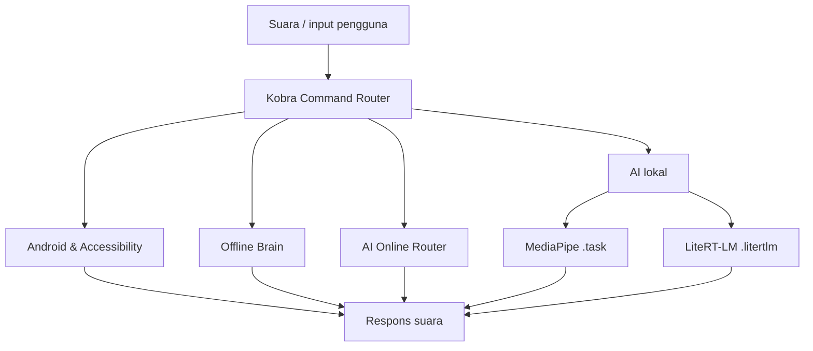

<div align="center">


# KOBRA OS
### Asisten Suara & Mata Kedua untuk Android

**Akses ponsel dengan suara. Baca informasi di sekitar. Tetap gunakan fungsi inti saat offline.**

[**UNDUH APK KOBRA OS — BUILD MAIN TERBARU**](https://github.com/adebojel/Asisten-bantu/releases/latest/download/Kobra-OS-main.apk) · [Semua versi](https://github.com/adebojel/Asisten-bantu/releases) · [Status build APK](https://github.com/adebojel/Asisten-bantu/actions/workflows/release.yml) · [Source Android](https://github.com/adebojel/Asisten-bantu/tree/main) · [Laporkan masalah](https://github.com/adebojel/Asisten-bantu/issues)


</div>

---

## Tentang Kobra OS

Kobra OS adalah aplikasi Android aksesibilitas yang dikembangkan untuk membantu pengguna, terutama tunanetra dan pengguna dengan keterbatasan penglihatan, mengoperasikan ponsel melalui suara dan mendapatkan informasi dari kamera maupun layar.

Arah pengembangannya adalah **satu asisten hybrid**: fungsi ringan berjalan lokal, sedangkan permintaan yang membutuhkan penalaran lebih luas dapat diteruskan ke AI online jika jaringan dan provider tersedia.

> **Status pengujian:** commit `83d921b` di `main` telah melewati workflow `Build Kobra OS APK` #251 dan `Auto Build and Release` #134; keduanya sukses dan aset APK serta checksum tersedia pada rilis Build 134. Tes logika murni dan kompilasi Android berhasil di CI. Belum ada verifikasi menyeluruh pada perangkat Android fisik. Build berhasil tidak membuktikan mikrofon, kamera, inferensi model, aksesibilitas, atau perilaku latar belakang bekerja sempurna.

## Tampilan aplikasi

Artwork 3D di bagian atas adalah ilustrasi identitas produk. Screenshot aplikasi asli yang dikirim digunakan sebagai acuan perbaikan UI; screenshot belum ditambahkan sebagai aset repository. Artwork banner 3D tambahan sudah dibuat untuk pembaruan identitas visual, tetapi belum tersedia sebagai file repository yang dapat ditautkan secara permanen. Karena itu README hanya menampilkan artwork SVG yang memang sudah tersimpan di repository, bukan tautan gambar yang belum ada.

| Beranda Kobra OS | Pilihan fitur Mata Kedua |
|---|---|
| Header status, indikator baterai/RAM/jaringan, orb suara, dan kartu modul | Pilihan pembaca uang, OCR, barcode, objek, terjemahan, dan KTP |

**Arah desain UI yang sedang dikerjakan**
- Tampilan gelap modern dengan aksen cyan dan indikator status yang jelas.
- Header ringkas; status baterai, RAM, jaringan, dan aksesibilitas tidak saling bertumpuk.
- Kartu fitur lebih padat dan konsisten agar ruang layar utama lebih luas.
- Dialog dan menu lebih ringkas, mudah dibaca, serta tetap nyaman disentuh.
- Kontras teks dan label tombol harus tetap tinggi. Minimalis tidak boleh mengurangi aksesibilitas.

## Kemampuan utama

| Modul | Fungsi |
|---|---|
| Kontrol suara | Membuka aplikasi, navigasi layar, dan menjalankan perintah yang diizinkan Android |
| Aksesibilitas | Membaca teks layar dan berinteraksi dengan elemen antarmuka melalui Accessibility Service |
| Mata Kedua | OCR, warna pakaian, wajah, barcode/QR, dan pengenalan objek |
| Mode Tongkat | Panduan arah objek berbasis kamera, suara, dan getaran; bukan pengganti tongkat putih |
| Komunikasi | Alur panggilan, SMS, notifikasi, dan aplikasi pesan dengan izin serta konfirmasi |
| Otak offline | Perintah dasar, kalkulator, dan basis pengetahuan lokal |
| AI online | Router provider ketika internet dan konfigurasi tersedia |
| AI lokal | Runtime MediaPipe dan LiteRT-LM untuk model yang kompatibel |

Ketersediaan fitur bergantung pada versi Android, izin, perangkat, koneksi, provider, dan model. Chat, input suara dari chat, dan perintah global diarahkan ke jalur percakapan yang sama; riwayat chat disimpan lokal dan dipulihkan saat layar chat dibuka kembali. Mode percakapan hands-free saat ini bergiliran mendengar dan berbicara melalui SpeechRecognizer/TTS Android, bukan audio streaming full-duplex berlatensi rendah. Analisis kamera berjalan saat layar Mata Kedua aktif; kamera tidak dijanjikan terus berjalan setelah Activity ditutup.

## AI hybrid: online dan offline

Paket APK menyertakan **otak offline dasar Kobra** (mesin aturan, kalkulator, dan basis pengetahuan `kobra_kb.txt`); ini bukan LLM generatif penuh. Build `main` saat ini juga mengunduh model Qwen3 0.6B INT4 ketika Gradle melakukan build bersih, lalu mengemas berkas `.litertlm` sebagai aset APK. Saat pertama kali dipakai, model disalin secara asinkron ke penyimpanan privat aplikasi sebelum LiteRT-LM memuatnya. Build 134 menghasilkan APK sekitar 645 MB, sehingga ukuran unduhan dan ruang penyimpanan harus diperhitungkan. Runtime tetap memeriksa ketersediaan model dan RAM; model tidak dijamin berjalan pada semua perangkat. Jika model gagal/tidak tersedia, Kobra harus kembali ke perintah lokal dan basis pengetahuan. Pengenalan suara offline tetap bergantung pada dukungan dan paket bahasa offline layanan SpeechRecognizer Android.

| Jalur | Format | Runtime |
|---|---|---|
| Gemma on-device | `.task` | MediaPipe LLM Inference |
| Qwen LiteRT-LM | `.litertlm` | LiteRT-LM |

Rilis **Kobra Offline Models v1.0** tetap tersedia sebagai paket model terpisah untuk impor manual dan pemulihan:

[**Buka Kobra Offline Models v1.0**](https://github.com/adebojel/Asisten-bantu/releases/tag/kobra-offline-models-v1.0)

Model tidak otomatis cocok untuk setiap ponsel. Kobra menggunakan pemeriksaan memori dan jalur fallback; jika model gagal dimuat, fungsi dasar tetap harus dapat digunakan.

## Unduh dan instalasi

<details>
<summary><strong>Unduh aplikasi Kobra OS (APK)</strong></summary>

**[UNDUH APK KOBRA OS — BUILD MAIN TERBARU](https://github.com/adebojel/Asisten-bantu/releases/latest/download/Kobra-OS-main.apk)**

> Tautan ini selalu mengarah ke APK dari rilis **Latest** branch `main`. Rilis model **Kobra OS Offline Models** terpisah dan bukan APK aplikasi.

Tautan langsung: [Kobra-OS-main.apk](https://github.com/adebojel/Asisten-bantu/releases/latest/download/Kobra-OS-main.apk) · [Checksum SHA-256](https://github.com/adebojel/Asisten-bantu/releases/latest/download/SHA256SUMS.txt) · [Halaman rilis terbaru](https://github.com/adebojel/Asisten-bantu/releases/latest)

Di halaman Releases:
1. Buka rilis **Latest** bernama Kobra OS. Rilis APK utama tidak lagi ditandai Pre-release.
2. Pada bagian **Assets**, pilih berkas `.apk` untuk mengunduh aplikasi.
3. Unduh `SHA256SUMS.txt` bila ingin memeriksa integritas file.
4. Setelah unduhan selesai, buka APK dan ikuti konfirmasi instalasi Android. Android mungkin meminta izin instalasi dari sumber ini.

Jika tautan langsung tidak terbuka, buka halaman Latest Releases atau periksa [status workflow rilis APK](https://github.com/adebojel/Asisten-bantu/actions/workflows/release.yml).

</details>

- **Semua versi dan catatan rilis:** [GitHub Releases](https://github.com/adebojel/Asisten-bantu/releases)
- **Status build/publikasi otomatis:** [Kobra OS — Auto Build and Release](https://github.com/adebojel/Asisten-bantu/actions/workflows/release.yml)
- **Model offline Qwen3 0.6B:** build `main` saat ini sudah mengemas Qwen3 di dalam APK; impor manual dari [Kobra Offline Models v1.0](https://github.com/adebojel/Asisten-bantu/releases/tag/kobra-offline-models-v1.0) hanya diperlukan untuk paket model terpisah/pemulihan. Pastikan ruang penyimpanan dan RAM memadai.

**Status distribusi:** workflow `main` membangun APK debug, membuat checksum SHA-256, dan menerbitkan aset pada GitHub Releases. Build 134 saat ini berstatus Latest dan bukan draft/pre-release. Meskipun workflow berhasil, build ini tetap belum dinyatakan stabil atau lulus uji perangkat; gunakan sebagai build kandidat untuk pengujian setelah tahap pengembangan kode selesai.

## Status pengembangan

- [x] Fondasi perintah offline dan router AI online.
- [x] Pemisahan jalur runtime model `.task` dan `.litertlm`.
- [x] Paket model offline tersedia terpisah.
- [x] Pemeriksaan RAM sebelum pemuatan model lokal.
- [x] Chat mencoba Gemma lokal, lalu Qwen3 LiteRT-LM lokal sebelum AI online.
- [x] Callback runtime Qwen dikembalikan ke main thread untuk menjaga keamanan UI Android.
- [x] Riwayat chat terpadu (suara/teks dan respons lokal/online) disimpan lokal dan dipulihkan saat chat dibuka kembali.
- [x] Fallback perintah dan pengetahuan dasar tetap tersedia ketika model generatif tidak bisa dimuat.
- [x] Fallback pengenalan objek ke Image Labeling ditambahkan pada branch pengembangan.
- [x] Build Android `main` dan tes unit untuk commit `83d921b` (workflow APK #251 dan rilis #134 berhasil; aset APK tersedia).
- [ ] Audit dan pengujian fungsional di HP Android nyata (sengaja ditunda sampai pengembangan kode selesai; ikuti [UJI_DI_HP.md](UJI_DI_HP.md)).
- [ ] Uji mikrofon pada layar terkunci dan penggunaan latar belakang.
- [ ] Uji alur tunanetra end-to-end dengan TalkBack.
- [ ] Penyempurnaan visual seluruh layar dan dialog.
- [ ] Integrasi kamera + pembacaan layar dalam satu sesi asisten yang tetap hidup lintas Activity.
- [ ] Penyempurnaan kendali suara lintas aplikasi dan ketahanan percakapan dua arah.
- [ ] Screenshot autentik dari build terbaru.

Panduan pengujian: [UJI_DI_HP.md](UJI_DI_HP.md).

## Arsitektur singkat




## Build dari source

Branch utama: `main`. Perubahan pengembangan dari `kobra-os-v7` telah digabung melalui PR #1.

```bash
git clone --branch main https://github.com/adebojel/Asisten-bantu.git
cd Asisten-bantu
./gradlew testDebugUnitTest assembleDebug
```

APK debug, jika build berhasil, berada di `app/build/outputs/apk/debug/app-debug.apk`.

## Privasi dan batasan Android

- API key provider AI harus disimpan sebagai rahasia dan tidak boleh di-commit.
- Jalur AI online otomatis saat ini memerlukan API key OpenRouter yang dimasukkan pengguna. Router hanya memilih model yang harga input dan output-nya terdeteksi nol pada katalog provider dan memverifikasi ulang sebelum request; tidak ada jaminan model gratis selalu tersedia. Tanpa key/provider gratis yang tersedia, Kobra kembali ke model lokal dan pengetahuan offline.
- Aplikasi biasa tidak dapat bebas mengaktifkan atau menonaktifkan Wi-Fi/data seluler.
- TalkBack tetap dikendalikan oleh pengguna melalui pengaturan Android.
- Pembacaan notifikasi dan SMS dapat membacakan informasi pribadi; aktifkan hanya jika diperlukan.
- Panggilan, pesan, dan SOS harus melalui konfirmasi pengguna.
- Kobra OS adalah alat bantu eksperimental, bukan pengganti tongkat putih, pendamping, atau layanan darurat.

## Kontribusi dan laporan bug

Gunakan [Issues](https://github.com/adebojel/Asisten-bantu/issues) untuk melaporkan masalah. Sertakan model HP, versi Android, langkah reproduksi, perilaku yang diharapkan, dan hasil aktual. Samarkan nomor telepon, lokasi, pesan, serta data pribadi pada screenshot atau log.

<div align="center">

**KOBRA OS — satu asisten, suara sebagai kendali.**

</div>
