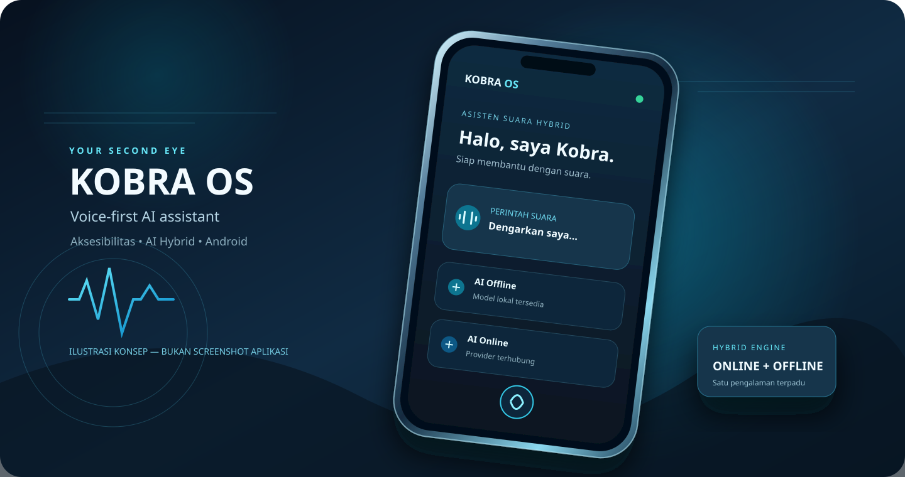
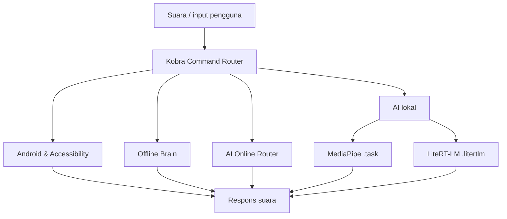

<div align="center">



# KOBRA OS
### Asisten Suara & Mata Kedua untuk Android

**Akses ponsel dengan suara. Baca informasi di sekitar. Tetap gunakan fungsi inti saat offline.**

[**UNDUH APK KOBRA OS — BUILD MAIN TERBARU**](https://github.com/adebojel/Asisten-bantu/releases/latest/download/Kobra-OS-main.apk) · [Semua versi](https://github.com/adebojel/Asisten-bantu/releases) · [Status build APK](https://github.com/adebojel/Asisten-bantu/actions/workflows/release.yml) · [Source Android](https://github.com/adebojel/Asisten-bantu/tree/main) · [Laporkan masalah](https://github.com/adebojel/Asisten-bantu/issues)


</div>

---

## Tentang Kobra OS

Kobra OS adalah aplikasi Android aksesibilitas yang dikembangkan untuk membantu pengguna, terutama tunanetra dan pengguna dengan keterbatasan penglihatan, mengoperasikan ponsel melalui suara dan mendapatkan informasi dari kamera maupun layar.

Arah pengembangannya adalah **satu asisten hybrid**: fungsi ringan berjalan lokal, sedangkan permintaan yang membutuhkan penalaran lebih luas dapat diteruskan ke AI online jika jaringan dan provider tersedia.

> **Status pengujian:** build historis `57aa88f` dan APK rilis sebelumnya telah lulus. Untuk pembaruan aksesibilitas terbaru, workflow #360 sudah melewati tahap tes logika/unit; kompilasi APK masih berjalan. Belum ada verifikasi menyeluruh pada perangkat Android fisik. Build berhasil tidak membuktikan mikrofon, kamera, inferensi model, panggilan, WhatsApp, atau perilaku latar belakang bekerja sempurna.

## Tampilan aplikasi

Artwork 3D di bagian atas adalah ilustrasi identitas produk. Screenshot aplikasi asli yang dikirim digunakan sebagai acuan perbaikan UI; screenshot belum ditambahkan sebagai aset repository. Artwork banner 3D tambahan sudah dibuat untuk pembaruan identitas visual, tetapi belum tersedia sebagai file repository yang dapat ditautkan secara permanen. Karena itu README hanya menampilkan artwork SVG yang memang sudah tersimpan di repository, bukan tautan gambar yang belum ada.

| Beranda Kobra OS | Pilihan fitur Mata Kedua |
|---|---|
| Header status, indikator baterai/RAM/jaringan, orb suara, dan kartu modul | Pilihan pembaca uang, OCR, barcode, objek, terjemahan, dan KTP |

**Arah desain UI yang sedang dikerjakan**
- Tampilan gelap modern dengan aksen cyan dan indikator status yang jelas.
- Header ringkas; status baterai, RAM, jaringan, dan aksesibilitas tidak saling bertumpuk.
- Kartu fitur lebih padat dan konsisten agar ruang layar utama lebih luas.
- Dialog dan menu lebih ringkas, mudah dibaca, serta tetap nyaman disentuh.
- Kontras teks dan label tombol harus tetap tinggi. Minimalis tidak boleh mengurangi aksesibilitas.

## Kemampuan utama

| Modul | Fungsi |
|---|---|
| Kontrol suara | Membuka aplikasi, navigasi layar, dan menjalankan perintah yang diizinkan Android |
| Aksesibilitas suara | Membaca teks, label, kontrol, dan target teks layar; memilih kontrol semantik atau mengetuk area teks melalui Accessibility Service dan gestur |
| Interoperabilitas TalkBack | Membuka pengaturan TalkBack/Accessibility Suite Android, membaca status layanan TalkBack yang benar, dan menerima event fokus aksesibilitas |
| Garis fokus kata | Batas transparan sangat tipis mengikuti satu kata; overlay berukuran hanya sebesar kata dan tidak menerima sentuhan. Jika rentang seleksi kata dan koordinat karakter tidak disediakan aplikasi, batas kata disembunyikan |
| Navigasi suara | Fokus pertama/terakhir/berikutnya/sebelumnya, navigasi kata berikutnya/sebelumnya, membaca kata fokus, dan membaca layar dari awal |
| Mata Kedua Terpadu | Satu sesi kamera: OCR langsung, label objek offline, panduan posisi teks, senter adaptif, dan perintah analisis sesuai pertanyaan |
| Tongkat Digital | Terintegrasi ke Mata Kedua Terpadu; deteksi label tidak mengukur jarak/arah dan bukan pengganti tongkat putih |
| Komunikasi | Alur panggilan, SMS, notifikasi, dan aplikasi pesan dengan izin serta konfirmasi |
| Otak offline | Perintah dasar, kalkulator, dan basis pengetahuan lokal |
| AI online | Router provider ketika internet dan konfigurasi tersedia |
| AI lokal | Runtime MediaPipe dan LiteRT-LM untuk model yang kompatibel |

Voice Access Kobra mengindeks kontrol interaktif serta label/teks layar yang diekspos pohon aksesibilitas; target teks yang tidak memiliki aksi klik dicoba melalui gestur ketuk pada koordinat teks. Pencocokan nama menghindari memilih kecocokan parsial pertama ketika ada beberapa target mirip. Untuk aplikasi yang menggambar antarmuka di canvas, menyembunyikan teks dari AccessibilityNodeInfo, memakai jendela aman, atau memblokir screenshot/gestur, target dapat tetap tidak tersedia dan Kobra harus mengatakannya dengan jujur. Perintah "baca saldo" hanya mengekstrak nominal yang berlabel saldo dan benar-benar tampil pada teks layar; ia tidak membuka kunci halaman, membaca PIN/OTP, atau mengambil data tersembunyi.

Tampilan global Kobra kini diprioritaskan agar layar tetap bersih: hanya ikon mikrofon kecil 44dp yang mengambang. Lencana nomor dan grid visual tidak lagi ditampilkan; indeks target dibacakan dan pemilihan dapat dilakukan dengan suara. Garis fokus bukan jendela layar penuh: overlay non-interaktif hanya dibuat sebesar batas kata yang sedang dipilih, dan disembunyikan jika provider tidak menyediakan geometri kata, tanpa latar, dimming, glow, atau panel. Navigasi kata menggunakan granularitas teks Android dan koordinat karakter yang disediakan oleh AccessibilityNodeInfo. Perintah yang tersedia: "Kobra kata berikutnya", "Kobra kata sebelumnya", "Kobra baca kata fokus", "Kobra klik kata ini", "Kobra ketuk B3", dan "Kobra geser A1 ke C5". Kobra juga menerima "Kobra fokus pertama", "Kobra fokus berikutnya", "Kobra fokus sebelumnya", "Kobra fokus terakhir", "Kobra baca fokus", dan "Kobra baca dari atas". Jika aplikasi tidak memberikan rentang seleksi dan koordinat karakter, Kobra tidak membuat batas kata palsu. Outline asli milik TalkBack tetap diatur oleh Android dan tidak dapat diubah oleh aplikasi Kobra.

Pengaturan suara dapat diubah dengan perintah "Kobra bicara lebih cepat", "Kobra bicara lebih lambat", "Kobra kecepatan bicara normal", "Kobra suara lebih tinggi", dan "Kobra suara lebih rendah". Perintah "Kobra menu aksesibilitas" memanggil tombol aksesibilitas Android jika shortcut telah dikonfigurasi. Untuk daftar proyek open-source yang diaudit, lisensi, dan keputusan integrasinya, lihat [OPEN_SOURCE_INTEGRATION_AUDIT.md](OPEN_SOURCE_INTEGRATION_AUDIT.md). Untuk peta ekspansi yang lebih mendalam—agent Android, model lokal, OCR/vision, audio offline, navigasi, prioritas integrasi, dan batas Android—lihat [OPEN_SOURCE_EXPANSION_ROADMAP.md](OPEN_SOURCE_EXPANSION_ROADMAP.md).

## AI hybrid: online dan offline

Paket APK menyertakan **otak offline dasar Kobra** (mesin aturan, kalkulator, dan basis pengetahuan `kobra_kb.txt`); ini bukan LLM generatif penuh. Build `main` mengemas Qwen3 0.6B INT4 LiteRT-LM sebagai model lokal. Runtime memeriksa ketersediaan model dan RAM; jika model gagal dimuat, Kobra kembali ke perintah lokal dan basis pengetahuan. APK Build 160 berukuran sekitar 645 MB, sehingga ruang unduhan dan penyimpanan harus diperhitungkan. Jalur AI online gratis memerlukan API key OpenRouter dari pengguna dan ketersediaan model gratis; kuota/model tidak dijamin selalu tersedia. Pengenalan suara offline bergantung pada dukungan dan paket bahasa offline Android.

| Jalur | Format | Runtime |
|---|---|---|
| Gemma on-device | `.task` | MediaPipe LLM Inference |
| Qwen LiteRT-LM | `.litertlm` | LiteRT-LM |

Rilis **Kobra Offline Models v1.0** tetap tersedia sebagai paket model terpisah untuk impor manual dan pemulihan:

[**Buka Kobra Offline Models v1.0**](https://github.com/adebojel/Asisten-bantu/releases/tag/kobra-offline-models-v1.0)

Model tidak otomatis cocok untuk setiap ponsel. Kobra menggunakan pemeriksaan memori dan jalur fallback; jika model gagal dimuat, fungsi dasar tetap harus dapat digunakan.

## Unduh dan instalasi

<details>
<summary><strong>Unduh aplikasi Kobra OS (APK)</strong></summary>

**[UNDUH APK KOBRA OS — BUILD MAIN TERBARU](https://github.com/adebojel/Asisten-bantu/releases/latest/download/Kobra-OS-main.apk)**

> Tautan ini selalu mengarah ke APK dari rilis **Latest** branch `main`. Rilis model **Kobra OS Offline Models** terpisah dan bukan APK aplikasi.

Tautan langsung: [Kobra-OS-main.apk](https://github.com/adebojel/Asisten-bantu/releases/latest/download/Kobra-OS-main.apk) · [Checksum SHA-256](https://github.com/adebojel/Asisten-bantu/releases/latest/download/SHA256SUMS.txt) · [Halaman rilis terbaru](https://github.com/adebojel/Asisten-bantu/releases/latest)

Di halaman Releases:
1. Buka rilis **Latest** bernama Kobra OS. Rilis APK utama tidak lagi ditandai Pre-release.
2. Pada bagian **Assets**, pilih berkas `.apk` untuk mengunduh aplikasi.
3. Unduh `SHA256SUMS.txt` bila ingin memeriksa integritas file.
4. Setelah unduhan selesai, buka APK dan ikuti konfirmasi instalasi Android. Android mungkin meminta izin instalasi dari sumber ini.

Jika tautan langsung tidak terbuka, buka halaman Latest Releases atau periksa [status workflow rilis APK](https://github.com/adebojel/Asisten-bantu/actions/workflows/release.yml).

</details>

- **Semua versi dan catatan rilis:** [GitHub Releases](https://github.com/adebojel/Asisten-bantu/releases)
- **Status build/publikasi otomatis:** [Kobra OS — Auto Build and Release](https://github.com/adebojel/Asisten-bantu/actions/workflows/release.yml)
- **Model offline Qwen3 0.6B:** build `main` saat ini sudah mengemas Qwen3 di dalam APK; impor manual dari [Kobra Offline Models v1.0](https://github.com/adebojel/Asisten-bantu/releases/tag/kobra-offline-models-v1.0) hanya diperlukan untuk paket model terpisah/pemulihan. Pastikan ruang penyimpanan dan RAM memadai.

**Status distribusi:** Build 171 adalah rilis APK terbaru yang sudah dipublikasikan untuk commit `57aa88f`. Tes unit dan kompilasi APK lulus pada workflow rilis #171. Semua APK adalah kandidat debug, bukan versi final yang sudah lulus uji perangkat.

## Status pengembangan

- [x] Fondasi perintah offline dan router AI online.
- [x] Pemisahan jalur runtime model `.task` dan `.litertlm`.
- [x] Paket model offline tersedia terpisah.
- [x] Pemeriksaan RAM sebelum pemuatan model lokal.
- [x] Chat mencoba Gemma lokal, lalu Qwen3 LiteRT-LM lokal sebelum AI online.
- [x] Callback runtime Qwen dikembalikan ke main thread untuk menjaga keamanan UI Android.
- [x] Riwayat chat terpadu (suara/teks dan respons lokal/online) disimpan lokal dan dipulihkan saat chat dibuka kembali.
- [x] Fallback perintah dan pengetahuan dasar tetap tersedia ketika model generatif tidak bisa dimuat.
- [x] Fallback pengenalan objek offline ke Image Labeling pada `main` tanpa klaim arah/jarak.
- [x] Workflow APK dan rilis menjalankan `testDebugUnitTest` sebelum `assembleDebug`.
- [x] Build #160 berhasil; workflow rilis #171 untuk commit `57aa88f` lulus tes dan kompilasi.
- [x] Entry point Mata Kedua Terpadu + Tongkat Digital memakai sesi kamera `live_companion`.
- [x] Voice Access suara: target bernomor dibacakan, grid visual disembunyikan, koordinat suara 10×10, ketik/gulir/klik, dan interupsi ucapan parsial.
- [x] Fokus kata: navigasi kata berikutnya/sebelumnya dan batas transparan berukuran kata saat Android menyediakan koordinat karakter.
- [x] Overlay global dipangkas: hanya ikon mikrofon kecil yang mengambang; batas kata dibuat sebagai jendela kecil non-interaktif.
- [x] Daftar WhatsApp dibaca berdasarkan nama percakapan; alur balasan teks meminta konfirmasi.
- [x] Status panggilan hanya diumumkan jika label status terlihat pada layar.
- [ ] Balasan voice note native otomatis; belum tersedia dan tidak disimulasikan.
- [ ] Pemilihan SIM 1/SIM 2 yang tervalidasi.
- [ ] Screen sharing/capture visual lintas aplikasi dalam satu sesi dengan izin MediaProjection.
- [ ] Audit dan pengujian fungsional di HP Android nyata (sengaja ditunda sampai pengembangan kode selesai; ikuti [UJI_DI_HP.md](UJI_DI_HP.md)).
- [ ] Uji mikrofon pada layar terkunci, latar belakang, dan alur tunanetra end-to-end dengan TalkBack.
- [ ] Penyempurnaan visual seluruh layar dan dialog serta screenshot autentik dari build terbaru.

Panduan pengujian: [UJI_DI_HP.md](UJI_DI_HP.md).

## Arsitektur singkat




## Build dari source

Branch utama: `main`. Branch lama dan PR yang sudah digantikan diaudit; perubahan relevan dipertahankan atau disempurnakan di `main`, sedangkan implementasi lama yang berisiko tidak digabung ulang.

```bash
git clone --branch main https://github.com/adebojel/Asisten-bantu.git
cd Asisten-bantu
./gradlew testDebugUnitTest assembleDebug
```

APK debug, jika build berhasil, berada di `app/build/outputs/apk/debug/app-debug.apk`.

## Batasan fungsi saat ini

- Image Labeling offline tidak menyediakan bounding box, arah, atau jarak. Kobra bukan pengganti tongkat putih dan tidak boleh dipakai untuk menyimpulkan jalur aman atau menyeberang.
- Panduan posisi kamera berasal dari bounding box teks OCR, bukan deteksi tepi uang atau objek yang terkalibrasi.
- Pembacaan nominal uang berbasis OCR perlu verifikasi; penghitungan banyak lembar uang dalam satu frame belum dapat dijamin.
- Penghitung orang memakai deteksi wajah, bukan jaminan jumlah seluruh orang yang tertutup atau tidak menghadap kamera.
- WhatsApp dibaca melalui teks yang diekspos Accessibility. Voice note hanya diputar jika kontrol pesan suara dikenali secara eksplisit; perekaman/pengiriman voice note native otomatis belum tersedia.
- Status panggilan hanya diumumkan jika teks status terlihat pada pohon aksesibilitas. Jika tidak, Kobra menyatakan status tidak terverifikasi. Pemilihan SIM 1/2 belum tersedia.
- Android membatasi layar aman, dialog sistem, izin, aplikasi yang memblokir Accessibility, dan tindakan tertentu. Voice Access tidak dapat menjamin kendali mutlak atas setiap aplikasi.
- Mata Kedua saat ini menggabungkan OCR dan label objek dalam satu sesi kamera; ini belum setara dengan streaming multimodal Gemini Live atau screen sharing penuh.

## Privasi dan batasan Android

- API key provider AI harus disimpan sebagai rahasia dan tidak boleh di-commit.
- Jalur AI online otomatis saat ini memerlukan API key OpenRouter yang dimasukkan pengguna. Router hanya memilih model yang harga input dan output-nya terdeteksi nol pada katalog provider dan memverifikasi ulang sebelum request; tidak ada jaminan model gratis selalu tersedia. Tanpa key/provider gratis yang tersedia, Kobra kembali ke model lokal dan pengetahuan offline.
- Aplikasi biasa tidak dapat bebas mengaktifkan atau menonaktifkan Wi-Fi/data seluler.
- TalkBack/Android Accessibility Suite adalah layanan Google terpisah. Kobra tidak menyalin APK/kode proprietary Google, tidak mengaktifkan TalkBack diam-diam, dan tidak menggantikan layanan sistem. Pengguna mengaktifkannya sendiri dari Pengaturan Aksesibilitas Android.
- Kobra dapat membaca event fokus aksesibilitas dan menyediakan navigasi/aksi suara sendiri. Bila TalkBack dan pembaca layar global Kobra sama-sama berbicara, keluaran dapat tumpang tindih; gunakan pengaturan pembaca layar Kobra secara sadar.
- Android membatasi aplikasi biasa: Kobra tidak dapat menjamin kendali mutlak pada layar aman, dialog izin sistem, UI yang tidak diekspos, atau aplikasi yang memblokir aksesibilitas. Fitur telepon/pesan/video call bergantung pada izin dan kontrol yang diekspos aplikasi tujuan.
- Saldo bank/e-wallet hanya boleh dibacakan dari informasi yang benar-benar tampil dan dapat diakses. Kobra tidak boleh meminta, menyimpan, atau membacakan PIN, kata sandi, CVV, maupun OTP; transfer/pembayaran tidak boleh dieksekusi tanpa konfirmasi eksplisit.
- Pembacaan notifikasi dan SMS dapat membacakan informasi pribadi; aktifkan hanya jika diperlukan.
- Panggilan, pesan, dan SOS harus melalui konfirmasi pengguna.
- Kobra OS adalah alat bantu eksperimental, bukan pengganti tongkat putih, pendamping, atau layanan darurat.

## Kontribusi dan laporan bug

Gunakan [Issues](https://github.com/adebojel/Asisten-bantu/issues) untuk melaporkan masalah. Sertakan model HP, versi Android, langkah reproduksi, perilaku yang diharapkan, dan hasil aktual. Samarkan nomor telepon, lokasi, pesan, serta data pribadi pada screenshot atau log.

<div align="center">

**KOBRA OS — satu asisten, suara sebagai kendali.**

</div>
