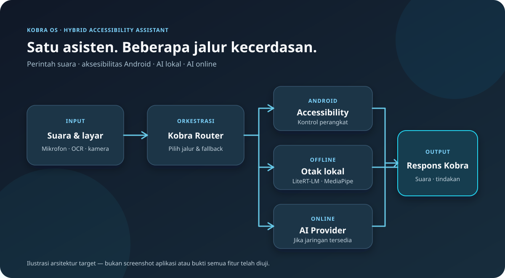
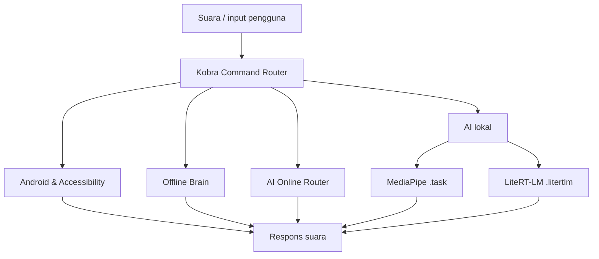

<div align="center">


# KOBRA OS
### Asisten Suara & Mata Kedua untuk Android

**Akses ponsel dengan suara. Baca informasi di sekitar. Tetap gunakan fungsi inti saat offline.**

[**Unduh APK**](https://github.com/adebojel/Asisten-bantu/releases) · [Build APK](https://github.com/adebojel/Asisten-bantu/actions) · [Source Android](https://github.com/adebojel/Asisten-bantu/tree/kobra-os-v7) · [Laporkan masalah](https://github.com/adebojel/Asisten-bantu/issues)


</div>

---

## Tentang Kobra OS

Kobra OS adalah aplikasi Android aksesibilitas yang dikembangkan untuk membantu pengguna, terutama tunanetra dan pengguna dengan keterbatasan penglihatan, mengoperasikan ponsel melalui suara dan mendapatkan informasi dari kamera maupun layar.

Arah pengembangannya adalah **satu asisten hybrid**: fungsi ringan berjalan lokal, sedangkan permintaan yang membutuhkan penalaran lebih luas dapat diteruskan ke AI online jika jaringan dan provider tersedia.

> **Status pengujian:** build sebelumnya berhasil di GitHub Actions. Integrasi deteksi objek offline dengan fallback Image Labeling sudah digabung ke branch `main`. GitHub Actions pada commit pengembangan sebelum merge berhasil menjalankan tes logika dan build APK. Belum ada verifikasi menyeluruh pada perangkat fisik. Build berhasil tidak berarti aplikasi bebas crash atau seluruh fitur telah bekerja.

## Tampilan aplikasi

Artwork 3D di bagian atas adalah ilustrasi identitas produk. Screenshot aplikasi asli yang dikirim digunakan sebagai acuan perbaikan UI; screenshot belum ditambahkan sebagai aset repository. Artwork banner 3D tambahan sudah dibuat untuk pembaruan identitas visual, tetapi belum tersedia sebagai file repository yang dapat ditautkan secara permanen. Karena itu README hanya menampilkan artwork SVG yang memang sudah tersimpan di repository, bukan tautan gambar yang belum ada.

| Beranda Kobra OS | Pilihan fitur Mata Kedua |
|---|---|
| Header status, indikator baterai/RAM/jaringan, orb suara, dan kartu modul | Pilihan pembaca uang, OCR, barcode, objek, terjemahan, dan KTP |

**Arah desain UI yang sedang dikerjakan**
- Tampilan gelap modern dengan aksen cyan dan indikator status yang jelas.
- Header ringkas; status baterai, RAM, jaringan, dan aksesibilitas tidak saling bertumpuk.
- Kartu fitur lebih padat dan konsisten agar ruang layar utama lebih luas.
- Dialog dan menu lebih ringkas, mudah dibaca, serta tetap nyaman disentuh.
- Kontras teks dan label tombol harus tetap tinggi. Minimalis tidak boleh mengurangi aksesibilitas.

## Kemampuan utama

| Modul | Fungsi |
|---|---|
| Kontrol suara | Membuka aplikasi, navigasi layar, dan menjalankan perintah yang diizinkan Android |
| Aksesibilitas | Membaca teks layar dan berinteraksi dengan elemen antarmuka melalui Accessibility Service |
| Mata Kedua | OCR, warna pakaian, wajah, barcode/QR, dan pengenalan objek |
| Mode Tongkat | Panduan arah objek berbasis kamera, suara, dan getaran; bukan pengganti tongkat putih |
| Komunikasi | Alur panggilan, SMS, notifikasi, dan aplikasi pesan dengan izin serta konfirmasi |
| Otak offline | Perintah dasar, kalkulator, dan basis pengetahuan lokal |
| AI online | Router provider ketika internet dan konfigurasi tersedia |
| AI lokal | Runtime MediaPipe dan LiteRT-LM untuk model yang kompatibel |

Ketersediaan fitur bergantung pada versi Android, izin, perangkat, koneksi, provider, dan model yang terpasang.

## AI hybrid: online dan offline

Kobra mempertahankan fungsi lokal untuk perintah dasar. Permintaan yang lebih kompleks dapat menggunakan AI online jika tersedia. Model lokal berjalan di perangkat dan memerlukan RAM, ruang penyimpanan, serta runtime yang sesuai.

| Jalur | Format | Runtime |
|---|---|---|
| Gemma on-device | `.task` | MediaPipe LLM Inference |
| Qwen LiteRT-LM | `.litertlm` | LiteRT-LM |

Paket model terpisah dari APK:

[**Buka Kobra Offline Models v1.0**](https://github.com/adebojel/Asisten-bantu/releases/tag/kobra-offline-models-v1.0)

Model tidak otomatis cocok untuk setiap ponsel. Kobra menggunakan pemeriksaan memori dan jalur fallback; jika model gagal dimuat, fungsi dasar tetap harus dapat digunakan.

## Unduh dan instalasi

- **APK rilis:** [GitHub Releases](https://github.com/adebojel/Asisten-bantu/releases)
- **APK debug:** [GitHub Actions](https://github.com/adebojel/Asisten-bantu/actions) → pilih run dengan status Success → unduh artifact `Kobra-OS-APK`.
- **Model offline:** [Kobra Offline Models v1.0](https://github.com/adebojel/Asisten-bantu/releases/tag/kobra-offline-models-v1.0).

Saat ini belum ada rilis APK stabil yang dinyatakan siap untuk penggunaan rutin. APK debug ditujukan untuk pengujian. Workflow prerelease APK sudah tersedia di [Kobra OS APK Release](.github/workflows/release-apk.yml); rilis baru dianggap tersedia setelah workflow dijalankan dan aset APK muncul di halaman Releases.

## Status pengembangan

- [x] Fondasi perintah offline dan router AI online.
- [x] Pemisahan jalur runtime model `.task` dan `.litertlm`.
- [x] Paket model offline tersedia terpisah.
- [x] Pemeriksaan RAM sebelum pemuatan model lokal.
- [x] Fallback pengenalan objek ke Image Labeling ditambahkan pada branch pengembangan.
- [x] Build Android dan tes logika setelah integrasi fallback (GitHub Actions berhasil pada commit sebelum merge).
- [ ] Uji instalasi dan fungsi di HP Android nyata.
- [ ] Uji mikrofon pada layar terkunci dan penggunaan latar belakang.
- [ ] Uji alur tunanetra end-to-end dengan TalkBack.
- [ ] Penyempurnaan visual seluruh layar dan dialog.
- [ ] Screenshot autentik dari build terbaru.

Panduan pengujian: [UJI_DI_HP.md](UJI_DI_HP.md).

## Arsitektur singkat





## Build dari source

Branch utama: `main`. Perubahan pengembangan dari `kobra-os-v7` telah digabung melalui PR #1.

```bash
git clone --branch kobra-os-v7 https://github.com/adebojel/Asisten-bantu.git
cd Asisten-bantu
./gradlew testDebugUnitTest assembleDebug
```

APK debug, jika build berhasil, berada di `app/build/outputs/apk/debug/app-debug.apk`.

## Privasi dan batasan Android

- API key provider AI harus disimpan sebagai rahasia dan tidak boleh di-commit.
- Provider gratis dapat memiliki kuota, batas kecepatan, atau berubah sewaktu-waktu.
- Aplikasi biasa tidak dapat bebas mengaktifkan atau menonaktifkan Wi-Fi/data seluler.
- TalkBack tetap dikendalikan oleh pengguna melalui pengaturan Android.
- Pembacaan notifikasi dan SMS dapat membacakan informasi pribadi; aktifkan hanya jika diperlukan.
- Panggilan, pesan, dan SOS harus melalui konfirmasi pengguna.
- Kobra OS adalah alat bantu eksperimental, bukan pengganti tongkat putih, pendamping, atau layanan darurat.

## Kontribusi dan laporan bug

Gunakan [Issues](https://github.com/adebojel/Asisten-bantu/issues) untuk melaporkan masalah. Sertakan model HP, versi Android, langkah reproduksi, perilaku yang diharapkan, dan hasil aktual. Samarkan nomor telepon, lokasi, pesan, serta data pribadi pada screenshot atau log.

<div align="center">

**KOBRA OS — satu asisten, suara sebagai kendali.**

</div>
