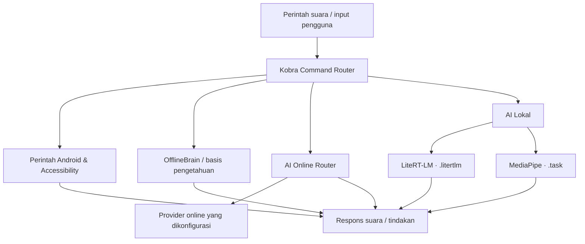

<div align="center">


# KOBRA OS
### Asisten Suara • Mata Kedua • AI Hybrid untuk Android

**Asisten aksesibilitas yang dirancang untuk membantu pengguna mengoperasikan ponsel dengan suara, membaca informasi di layar, dan tetap memiliki fungsi dasar saat offline.**

[📦 Download APK](https://github.com/adebojel/Asisten-bantu/actions) · [🧠 Download Model Lokal](https://github.com/adebojel/Asisten-bantu/releases/tag/kobra-offline-models-v1.0) · [🛠️ Source Code](https://github.com/adebojel/Asisten-bantu/tree/kobra-os-v7) · [🐞 Laporkan Bug](https://github.com/adebojel/Asisten-bantu/issues)


</div>

---

## 👋 Selamat datang di Kobra OS

Kobra OS (Asisten-bantu) adalah proyek asisten Android yang berfokus pada aksesibilitas suara dan konsep **“mata kedua”**. Tujuannya membantu pengguna, termasuk pengguna tunanetra, berinteraksi dengan fungsi ponsel melalui perintah suara, pembacaan teks, dan fitur bantuan.

Proyek ini sedang dikembangkan menuju arsitektur **AI hybrid**:

- **Offline:** perintah perangkat, basis pengetahuan lokal, dan model bahasa yang dipasang pengguna.
- **Online:** penyedia AI eksternal ketika koneksi dan konfigurasi tersedia.
- **Fallback:** jika layanan online gagal, aplikasi mencoba jalur lokal yang didukung perangkat.

> [!IMPORTANT]
> **Status pengembangan yang jujur (15 November 2026):** branch `kobra-os-v7` masih aktif dikembangkan. Fitur impor model `.task` dan `.litertlm`, fondasi runtime LiteRT-LM, serta jalur uji Qwen sedang diintegrasikan. Build pada beberapa commit integrasi terakhir masih menemukan error kompilasi dan sedang diperbaiki. **Belum ada APK dari commit terbaru yang dinyatakan siap uji, dan belum ada hasil uji perangkat nyata yang dapat diklaim.**
>
> Tombol download APK di atas membuka GitHub Actions. Unduh hanya artifact dari workflow terbaru yang berstatus **Success**. Jangan menggunakan artifact dari run yang gagal atau commit yang lebih lama.

## ✨ Fitur dan kemampuan proyek

| Area | Kemampuan yang ada / sedang dikembangkan |
|---|---|
| Kontrol suara | Perintah untuk membuka aplikasi, navigasi, dan fungsi ponsel yang diizinkan Android |
| Aksesibilitas | Integrasi layanan Accessibility, pembacaan teks layar, dan kontrol elemen antarmuka |
| Komunikasi | Alur kontak, panggilan, SMS, dan aplikasi pesan dengan batasan izin Android |
| Mata kedua | OCR, pengenalan warna, serta analisis visual pada jalur yang didukung |
| Otak offline dasar | Perintah lokal, kalkulator, dan basis pengetahuan berbasis aturan |
| AI online | Router provider dengan fallback; memerlukan jaringan dan/atau konfigurasi provider |
| AI lokal | Model MediaPipe `.task` dan jalur LiteRT-LM `.litertlm` sedang diintegrasikan |
| Manajemen model | Impor model ke penyimpanan privat aplikasi, pemisahan format, dan pemeriksaan memori |

Kemampuan tiap fitur bergantung pada izin, versi Android, perangkat, provider, serta model yang benar-benar terpasang. Tidak semua fitur dapat bekerja di semua ponsel.

## 🖼️ Tampilan dan screenshot aplikasi

<div align="center">

<br>
<sub>Ikon aplikasi Kobra OS</sub>
</div>

**Screenshot layar aplikasi yang autentik belum tersedia di repository saat README ini diperbarui.** Saya tidak menampilkan mockup atau gambar buatan seolah-olah itu hasil aplikasi yang sudah berjalan. Setelah APK terbaru lolos build dan dipasang di perangkat, bagian ini akan diisi dengan tangkapan layar asli, misalnya:

1. Beranda dan status aksesibilitas.
2. Panel pengaturan AI dan provider online.
3. Impor, status, dan uji model lokal.
4. Contoh interaksi suara dan pembacaan layar.
5. Tampilan izin serta panduan onboarding.

Kontribusi screenshot asli dapat dikirim melalui [Issues](https://github.com/adebojel/Asisten-bantu/issues) atau Pull Request. Mohon sembunyikan nomor telepon, pesan pribadi, lokasi rumah, dan data sensitif sebelum mengunggah.

## 🧠 AI lokal dan pilihan model

Kobra sedang menyiapkan dukungan untuk dua jalur runtime yang berbeda. Ekstensi file tidak dapat dipertukarkan.

| Model | Format | Runtime | Status |
|---|---|---|---|
| Gemma 3 1B IT INT4 | `.task` | MediaPipe LLM Inference | Jalur lama dipertahankan |
| Qwen3 0.6B INT4 No-Think | `.litertlm` | LiteRT-LM | Paket tersedia; integrasi aplikasi masih divalidasi |

### Download model Qwen3 0.6B

[**Buka Kobra Offline Models v1.0 di GitHub Releases**](https://github.com/adebojel/Asisten-bantu/releases/tag/kobra-offline-models-v1.0)

Release model berisi:
- File model Qwen3 0.6B `.litertlm`.
- File checksum SHA-256 untuk verifikasi integritas.
- Catatan lisensi dan sumber model.

**Penting:** file model bukan APK. Unduh model hanya untuk build Kobra yang sudah mendukung runtime LiteRT-LM. Model 0.6B lebih kecil daripada model 1B, tetapi bukan jaminan berjalan pada semua HP RAM kecil. Penggunaan memori dipengaruhi runtime, konteks, RAM yang tersedia, dan chipset.

### Rencana pemilihan model adaptif

- Periksa memori perangkat sebelum memuat model.
- Prioritaskan model lebih ringan pada perangkat terbatas.
- Gunakan CPU sebagai jalur kompatibilitas dasar.
- Lepaskan runtime saat tidak digunakan untuk mengembalikan RAM.
- Jika model gagal dimuat, pertahankan fungsi perintah dasar dan fallback yang tersedia.

## 📥 Download aplikasi

### APK Android

[**Buka halaman GitHub Actions**](https://github.com/adebojel/Asisten-bantu/actions)

Cara mengambil APK:
1. Buka link Actions.
2. Pilih workflow **Build Kobra OS APK** pada branch `kobra-os-v7`.
3. Pastikan hasil run berstatus **Success**.
4. Buka run tersebut, gulir ke bagian **Artifacts**, lalu unduh `Kobra-OS-APK`.
5. Ekstrak ZIP artifact untuk mendapatkan APK.

Jika artifact tidak tersedia, build belum berhasil atau artifact sudah kedaluwarsa. Jangan menganggap link Actions sebagai APK yang selalu siap diunduh.

### Release

- [Semua Releases](https://github.com/adebojel/Asisten-bantu/releases)
- [Offline Model Pack v1.0](https://github.com/adebojel/Asisten-bantu/releases/tag/kobra-offline-models-v1.0)

Saat ini link release model tidak boleh dianggap sebagai release APK. APK akan ditautkan di sini setelah ada release aplikasi yang valid dan teruji.

## 🚀 Instalasi dan persiapan uji

1. Unduh APK dari artifact workflow yang sukses.
2. Buka APK di Android dan izinkan pemasangan dari sumber yang digunakan bila Android memintanya.
3. Buka Kobra OS dan ikuti panduan izin satu per satu.
4. Aktifkan Accessibility Service hanya jika memang ingin menggunakan kontrol aksesibilitas.
5. Berikan izin mikrofon/kamera/notifikasi hanya untuk fitur yang ingin digunakan.
6. Untuk AI online, isi API key provider sendiri di Pengaturan AI. Jangan membagikan API key kepada orang lain.
7. Untuk AI lokal, impor file model yang formatnya sesuai runtime yang didukung APK.

**Uji keselamatan:** lakukan uji panggilan, pesan, SOS, dan kontrol perangkat dengan hati-hati. Jangan mengandalkan aplikasi ini sebagai satu-satunya alat navigasi atau keselamatan.

## 🧪 Checklist uji perangkat

| Pengujian | Hasil saat ini |
|---|---|
| Uji logika offline murni | Workflow menyediakan tes logika |
| Build APK commit integrasi terbaru | Masih dalam perbaikan |
| Instalasi APK di perangkat nyata | Belum diverifikasi |
| Impor model `.task` dan `.litertlm` | Implementasi sedang divalidasi |
| Qwen3 menghasilkan jawaban lokal | Belum diverifikasi pada perangkat |
| Fallback online ke lokal | Implementasi sedang divalidasi |
| TalkBack dan alur tunanetra end-to-end | Belum diverifikasi |

Panduan uji manual: [`UJI_DI_HP.md`](UJI_DI_HP.md).

## 🧩 Cara kerja arsitektur



Diagram ini menggambarkan rancangan jalur sistem, bukan bukti bahwa semua jalur sudah lulus pengujian.

## 🛠️ Teknologi

- Android native: Java dan Kotlin.
- Android Accessibility Service dan Text-to-Speech.
- MediaPipe LLM Inference untuk model `.task` yang sudah ada.
- LiteRT-LM untuk jalur model `.litertlm` yang sedang diintegrasikan.
- GitHub Actions untuk pengujian logika dan build APK.

## 🧑‍💻 Build dari source

Branch pengembangan: `kobra-os-v7`.

1. Clone repository:
   ```bash
   git clone --branch kobra-os-v7 https://github.com/adebojel/Asisten-bantu.git
   cd Asisten-bantu
   ```
2. Buka proyek di Android Studio dengan Android SDK yang sesuai.
3. Sinkronkan Gradle.
4. Jalankan build:
   ```bash
   ./gradlew assembleDebug
   ```
5. APK debug jika build berhasil berada di:
   ```
   app/build/outputs/apk/debug/app-debug.apk
   ```

GitHub Actions: [Build Kobra OS APK](https://github.com/adebojel/Asisten-bantu/actions/workflows/build-apk.yml).

## 🔐 Privasi, izin, dan keterbatasan

- API key provider AI harus dijaga sebagai rahasia. Jangan commit key ke repository.
- Provider AI online dapat memiliki kuota, batas kecepatan, perubahan layanan, dan kebijakan privasi sendiri.
- AI online gratis tidak berarti tanpa batas atau dijamin tersedia selamanya.
- Model lokal membutuhkan penyimpanan, RAM, CPU/GPU, dan baterai. Perangkat dengan memori terbatas mungkin tidak dapat menjalankan model tertentu.
- Android membatasi sebagian tindakan sistem untuk aplikasi biasa. Contohnya, aplikasi tidak dapat bebas mengaktifkan/menonaktifkan Wi-Fi atau data seluler.
- TalkBack adalah layanan aksesibilitas Android; Kobra tidak dapat diam-diam mengambil alih atau mengaktifkannya tanpa tindakan pengguna.
- Pembacaan notifikasi/SMS dapat mengungkap informasi pribadi. Aktifkan hanya jika diperlukan.
- Kobra adalah alat bantu eksperimental, bukan pengganti tongkat putih, anjing pemandu, pendamping, atau layanan darurat.

## 🗺️ Roadmap

- [x] Fondasi perintah offline dan AI online.
- [x] Pemisahan registry model `.task` dan `.litertlm`.
- [x] Paket model Qwen3 0.6B diterbitkan di Releases.
- [ ] Validasi build integrasi LiteRT-LM dan Qwen3.
- [ ] Uji pemuatan dan jawaban model Qwen3 pada Android nyata.
- [ ] Penyempurnaan pemilihan model berdasarkan kemampuan perangkat.
- [ ] Dokumentasi screenshot aplikasi dari perangkat nyata.
- [ ] Release APK stabil dengan checksum dan catatan perubahan.

## 🤝 Kontribusi dan laporan masalah

- [Buat Issue](https://github.com/adebojel/Asisten-bantu/issues/new/choose)
- [Lihat Pull Requests](https://github.com/adebojel/Asisten-bantu/pulls)
- [Lihat riwayat commit branch pengembangan](https://github.com/adebojel/Asisten-bantu/commits/kobra-os-v7)

Saat melaporkan bug, sertakan model HP, versi Android, langkah untuk mengulang masalah, hasil yang diharapkan, hasil aktual, dan log error bila tersedia. Hapus data pribadi dari screenshot/log.

---

<div align="center">

**Kobra OS — akses yang lebih mudah, satu perintah suara pada satu waktu.**

Dikembangkan secara bertahap. Fitur yang belum diuji akan tetap ditandai sebagai belum diverifikasi.

</div>
